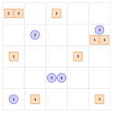
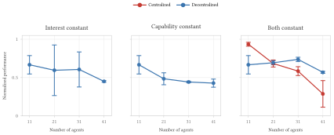

# Agent Interest and Capability

**Code and experiments for studying when decentralized value learning scales.**

[Paper (PDF)](https://www.cs.toronto.edu/~kutyashev/assets/aamas_paper.pdf) ·
[Experiment recipes](docs/reproduction.md) · [Usage guide](docs/usage.md)

Accompanying code for **Agent Interest and Capability: When Does Decentralized
Value Learning Scale?** by Tadd Mao, Kirill Utyashev, and Peter Marbach.
The paper is currently **under review at AAMAS 2027**.

<p align="center">
  
</p>

*Task-collection environment from the paper. Circles denote agents and squares
identify task types. Multiple agents and different task types can share a cell.*

The experiments study how decentralized value learning scales when each agent's
network width stays fixed. In the task-collection environment, **interest**
determines which task types contribute to an agent's reward, and **capability**
determines which task types it can complete.

- **Learning.** Centralized and decentralized after-state TD(λ), with the same
  environment, full CNN observation, network depth, and training budget.
- **Baselines.** An assignment-based planner and a greedy task-selection policy
  for evaluating team performance.
- **Experiments.** Configurations and commands for scaling agent count, varying
  network width, and comparing larger centralized networks.

## Install

The reference setup uses **Linux x86-64, Python 3.12, and uv 0.12.24 or newer**.
A CPU-only installation is sufficient for the quick start.

```bash
git clone https://github.com/KirillUtyashev/agent-interest-capability.git
cd agent-interest-capability
uv python install 3.12
uv sync --locked --extra cpu
```

Install [uv](https://docs.astral.sh/uv/getting-started/installation/) first if
needed. For NVIDIA GPU training, use `--extra cuda` in place of `--extra cpu`
and set `train.use_gpu=true`. See the [installation guide](docs/usage.md#installation)
for GPU requirements, pip installation, and platform details.

## Quick start

Run the short CPU example:

```bash
uv run --locked --extra cpu task-collection-train \
  --config src/task_collection/configs/examples/smoke_cpu.yaml
```

This runs 100 training turns and writes metrics and checkpoints beneath
`outputs/examples/smoke_cpu/`. It checks the training workflow; it is not a
performance benchmark.

Generate a configuration for a paper experiment:

```bash
uv run --locked --extra cpu task-collection-reproduce config \
  --family main --agents 21 --condition both-bounded \
  --method decentralized --width 8 --lr 1e-5 --seed 1235 \
  --output outputs/configs/main_both_n21.yaml
```

The command writes a self-contained YAML. Pass it to `task-collection-train`
to launch training. See the [experiment recipes](docs/reproduction.md) for
reporting budgets, learning rates, seeds, and the other experiment families.

## Main result

Keeping both interest and capability breadths constant better preserves
decentralized performance as the number of agents grows in these experiments.



*Main scaling experiment from the paper (Figure 2). Fixed breadths are 11;
remaining breadths grow with the number of agents. Scores are normalized by
the assignment-based planner. Error bars show one standard deviation across
three reporting seeds.*

All three conditions coincide at 11 agents. Each decentralized agent uses its
own width-8 network; the centralized learner uses one width-8 network.

## Reproducing the experiments

| Experiment | What varies | Recipe |
| --- | --- | --- |
| Main scaling figure | Agent count and interest/capability breadths | [Main scaling](docs/reproduction.md#main-scaling-figure) |
| Network-width sweep | Widths 1–64 at 11 agents | [Width sweep](docs/reproduction.md#network-width-sweep-at-fixed-n11) |
| Larger centralized networks | Width-64 centralized learning as agent count grows | [Centralized scaling](docs/reproduction.md#centralized-width-64-scaling) |

The [usage guide](docs/usage.md) covers the environment and reward construction,
planner baselines, output files, scoring, checkpoint continuation, tests, and
cluster use. The [example YAMLs](src/task_collection/configs/examples) can also
be passed directly to the training command.

The release includes source code, tests, documentation, and example configurations.
Experiment outputs are generated locally and are not bundled with the code.

## Citation

If you use this code in your research, please cite the accompanying manuscript:

```bibtex
@unpublished{mao_agent_interest_capability,
  title = {Agent Interest and Capability: When Does Decentralized Value Learning Scale?},
  author = {Tadd Mao and Kirill Utyashev and Peter Marbach},
  note = {Under review at AAMAS 2027},
  url = {https://www.cs.toronto.edu/~kutyashev/assets/aamas_paper.pdf}
}
```
